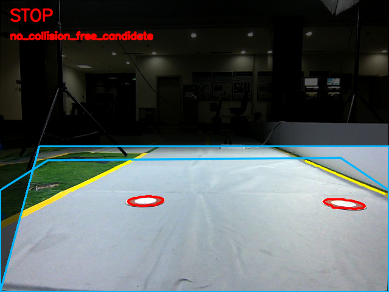

# 黄线识别算法解决方案说明

本文记录 `yellow_track_avoidance` 在当前场地、相机位置和固定光照下的黄线识别改造。当前阶段只解决原始相机画面中的左右黄线识别；BEV 米制标定、路径规划和车辆运动仍保持关闭。

## 1. 最终结论

旧方案已经由以下流程替代：

```text
六边形 ROI
  → Cr-Cb 连续黄色置信度
  → 沿左右赛道边界法向采样
  → 局部颜色峰值和脊线特征
  → 动态规划选择连续路径
  → 加权一般直线拟合
  → 当前帧严格质量门控
  → 只在真实观测范围内绘制
```

最重要的改变有三个：

1. 不再用水平行寻找黄色簇中心，而是垂直于黄线方向扫描。
2. 不再把二值掩膜作为拟合输入，而是保留连续黄色置信度。
3. 不再使用上一帧补线，也不把拟合结果延伸到没有当前帧证据的位置。

当前调试对比图：



## 2. 原方案为什么容易识别错误

### 2.1 水平扫描会把斜黄线放宽

左右黄线相对水平线只有约 17°～19°。水平行切过斜黄线时，看到的黄色区域宽度会被放大：

```text
水平截面宽度 = 黄线法向真实宽度 / sin(黄线角度)
```

角度为 18° 时约放大 3.2 倍。因此原来的“逐行黄色簇中心”天然容易出现宽簇，左侧黄绿色地毯再与黄线粘连后，簇中心就会被拉向地毯。

### 2.2 过早二值化会丢掉远端弱黄线

固定 HSV 阈值只能回答“是或不是黄色”。远端黄线低饱和、强光区接近过曝，同一根黄线的响应可能跨过阈值，最终变成断裂碎片。阈值放低又会把绿色地毯和反光带进来。

### 2.3 全 ROI 方向过滤既慢又不稳定

旧版结构张量需要对整个 ROI 计算局部方向，现场调试输出约为 5 Hz。远端黄线很细、低对比，局部方向本身也不稳定。新版直接在左右透视方向附近搜索，不再对每个像素做全局方向判断。

### 2.4 直线外推造成“地面没黄线但还在画”

直线拟合在数学上可以延伸到整幅图像；这不代表延伸区域存在黄色证据。旧版还可能使用历史结果补线，所以会出现底部没有黄线却仍然显示黄线的情况。

## 3. 检测区域

当前检测区域是六边形：

```text
(156,263) → (482,259) → (639,312)
     → (639,479) → (0,479) → (0,312)
```

它包含上方梯形以及梯形下方直到图像底部的全部区域。画面里的蓝色边框是在识别完成后画上去的，不会改变参与计算的像素颜色；但蓝框围成的范围就是实际 ROI，框外像素不会参与检测。

## 4. 连续黄色置信度

### 4.1 主颜色特征

图像通过 `cv_bridge` 明确转换成 `bgr8`，再转换到 YCrCb。主要黄色对手特征为：

```text
D = Cr - Cb
```

黄色通常表现为 Cr 较高、Cb 较低，因此 `Cr-Cb` 明显高于灰色路面。当前绝对黄色证据为：

```text
P_abs = sigmoid((D - 10) / 6)
```

### 4.2 绿色地毯惩罚

使用 RGB 中绿色相对红色的过量：

```text
green_excess = max(G - R, 0) / (R + G + B + 1)
P_green = sigmoid((green_excess - 0.015) / 0.01)
```

黄绿色地毯通常比黄色胶带具有更强的绿色过量。当前惩罚系数为 0.70。

### 4.3 白色反光惩罚

当亮度很高且 Cr、Cb 都接近中性值时，更可能是白色镜面反光：

```text
chroma = abs(Cr - 128) + abs(Cb - 128)
```

当前亮度中心为 245，低色度中心为 10，惩罚系数为 0.90。高亮但仍有明显黄色色度的像素不会被简单删除。

### 4.4 HSV 只做奖励

HSV 黄色 Hue 范围约为 10～42、峰值为 25。只有饱和度足够时，Hue 才以最高 0.20 的权重增加置信度。低饱和远端像素不会仅因 Hue 不稳定而被硬删除。

最终得到 0～1 的浮点置信度图。`yellow_mask` 只是阈值 0.40 后的调试显示，动态规划和拟合使用的是连续置信度，而不是这张硬掩膜。

## 5. 沿黄线法向采样

左右侧分别定义一条名义透视线：

```text
左侧：(185,268) → (0,340)
右侧：(445,260) → (639,330)
```

每侧生成 28 个截面，每个截面沿名义线的法向采样。搜索宽度从远端 ±25 px 逐渐扩大到近端 ±60 px，采样步长为 2 px。

每个法向位置计算四种证据：

1. 连续黄色基础置信度；
2. 与赛道内侧灰色路面参考相比的 `Cr-Cb` 增量；
3. 在 3、5、8、11 px 多尺度肩部之间的黄色脊线突出度；
4. 黄线朝赛道内侧方向的边缘强度。

截面综合分数为：

```text
S = 0.35 × 基础置信度
  + 0.30 × 局部颜色增量
  + 0.25 × 脊线突出度
  + 0.10 × 内侧边缘
```

这样即使左侧黄线与绿色地毯在二值图里连成宽块，算法也优先选择窄而突出的真实黄色脊线，而不是宽区域的几何中心。

## 6. 动态规划排除横线和碎片

每个截面上都有多个可能位置。动态规划从远端到近端选择一条总代价最低的连续路径：

```text
单点代价 = -log(截面分数) + 偏离名义线的代价
转移代价 = 0.12 × 相邻截面偏移变化²
```

相邻截面的法向偏移最多变化 8 px。真正的左右黄线可以连续穿过大多数截面；水平黄线、圆盘边缘和地面反光只能影响少数截面，无法组成符合透视方向的长路径，因此会自然被拒绝。

这就是新版不需要全 ROI 结构张量，也能做到“只认竖线和赛道方向斜线、不认横线”的原因。

## 7. 直线拟合与质量门控

动态规划得到路径后，只保留满足当前帧真实证据的点：

```text
截面综合分数 >= 0.40
基础黄色置信度 >= 0.18
黄色脊线突出度 >= 2.0
```

有效点使用加权总最小二乘拟合一般直线。权重同时考虑截面分数和脊线突出度，因此强证据点对结果影响更大。

每一侧还必须通过以下门控：

| 条件 | 当前值 |
|---|---:|
| 最少有效截面 | 12 |
| 最小支持率 | 0.38 |
| 最小覆盖率 | 0.50 |
| 最小中位置信度 | 0.40 |
| 最小中位突出度 | 3.0 |
| 最大拟合 RMS | 5.0 px |
| 最大连续内部缺失 | 6 个截面 |
| 最低综合质量 | 0.50 |

另外，左线必须满足左侧透视方向，右线必须满足右侧透视方向。任何一项不通过，该侧在当前帧就判定为无效。

## 8. 为什么现在不会乱延伸

新版执行以下硬规则：

1. 拟合完成后记录当前帧有效点的最小和最大图像行。
2. 直线数组在观测范围外全部写为 `NaN`。
3. 绘图时只连接有限值和当前观测范围内的点。
4. 当前帧失败时不显示该侧黄线。
5. `used_history` 永远为 `false`，上一帧不能代替当前帧测量。

因此，即使拟合出的数学直线可以继续到图像底部，只要那里没有当前帧支持点，画面就不会显示黄线。

## 9. 性能优化

初版 Python 法向检测完整管线约需 721 ms。之后进行了三项优化：

1. 只在六边形 ROI 的包围区域做 HSV、YCrCb 和浮点颜色计算；
2. 将逐采样点的 `np.interp` 改为整条剖面向量化计算；
3. 将同一侧的全部法向坐标合并，一次性调用 OpenCV `remap`。

最终 ROS 实际调试话题稳定在约 10 Hz，与相机帧率一致。全 ROI 结构张量过滤已关闭。

## 10. 当前现场验证结果

在 2026-07-21 当前固定曝光和现场光照下，连续读取 60 帧：

| 指标 | 结果 |
|---|---:|
| 左线检出 | 60/60 |
| 右线检出 | 60/60 |
| 双线同时检出 | 60/60 |
| 左侧有效截面中位数 | 28/28 |
| 右侧有效截面中位数 | 28/28 |
| 左侧拟合 RMS 中位数 | 约 1.03 px |
| 右侧拟合 RMS 中位数 | 约 0.77 px |
| 完整管线耗时 P50 | 约 96.8 ms |
| ROS 实际输出 | 约 10 Hz |
| 自动测试 | 22 项全部通过 |

这证明当前固定场景已经稳定，但 60 帧现场测试不等于多天气、多曝光、多相机姿态数据集上的 100% 泛化。正式验收仍应录制 rosbag，并统计遮挡、横线、强反光和无黄线帧。

## 11. 启动和检查

检测模式默认使用当前 `config/calibrated.yaml`，但 BEV 标定和运动仍关闭：

```bash
source /opt/ros/noetic/setup.bash
source /home/mo-bit/newznzc_ws1/devel/setup.bash
roslaunch yellow_track_avoidance detect_only.launch
```

查看实时叠加结果：

```bash
rqt_image_view /yellow_track_avoidance/debug/raw_overlay
```

主要调试话题：

```text
/yellow_track_avoidance/debug/raw_overlay
/yellow_track_avoidance/debug/yellow_score
/yellow_track_avoidance/debug/yellow_mask
/yellow_track_avoidance/debug/status
```

`status` 中应重点检查：

```text
profile_detector: true
left_detected / right_detected
left_valid_sections / right_valid_sections
left_fit_rms_px / right_fit_rms_px
boundary_used_history: false
motion_enabled: false
```

离线复现当前截图：

```bash
rosrun yellow_track_avoidance offline_image_test.py \
  --image /home/mo-bit/newznzc_ws1/src/yellow_track_avoidance/debug_captures/current_raw.png \
  --config /home/mo-bit/newznzc_ws1/src/yellow_track_avoidance/config/calibrated.yaml \
  --output-dir /tmp/yellow_detection_check \
  --repeat-frames 1
```

## 12. 代码位置

| 内容 | 文件 |
|---|---|
| 连续黄色置信度和 ROI 裁剪 | `src/yellow_track_avoidance/vision.py` |
| 法向剖面、动态规划和质量门控 | `src/yellow_track_avoidance/profile_boundary.py` |
| 管线接入和仅按观测范围绘图 | `src/yellow_track_avoidance/pipeline.py` |
| 当前现场参数 | `config/calibrated.yaml` |
| 自动测试 | `test/test_core.py` |
| 当前截图与离线结果 | `debug_captures/` |

## 13. 后续调参原则

不要重新围绕单一 HSV 阈值反复试。出现问题时按以下顺序检查：

1. 确认相机仍为固定曝光 480、增益 0、自动曝光关闭；
2. 确认 ROS 输入编码为 `rgb8`，代码转换目标为 `bgr8`；
3. 查看 `yellow_score`，确认真实黄线的连续响应高于地毯和反光；
4. 查看左右有效截面数、突出度和拟合 RMS；
5. 颜色错误时调 `yellow_confidence_v2`；
6. 路径跳动时调走廊宽度、最大相邻偏移和 DP 平滑权重；
7. 假线时提高质量门槛，漏线时先分析失败指标，再只放宽对应门槛。

当前车辆运动保持禁用。看到叠加图中的 `STOP / calibration_incomplete` 是预期安全状态，不代表黄线识别失败。
