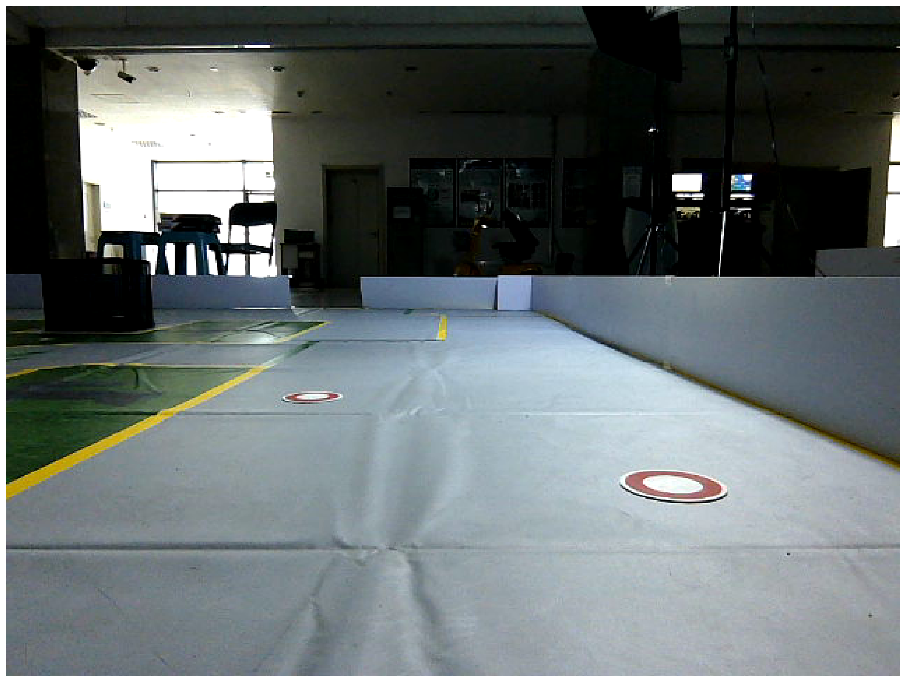
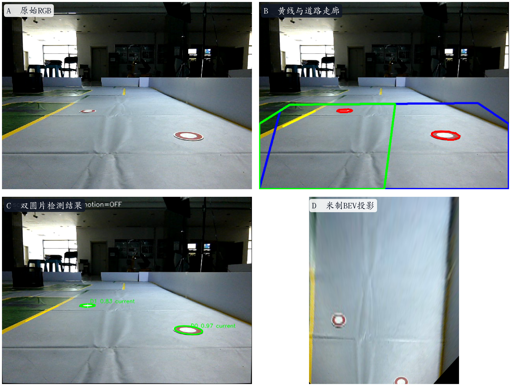
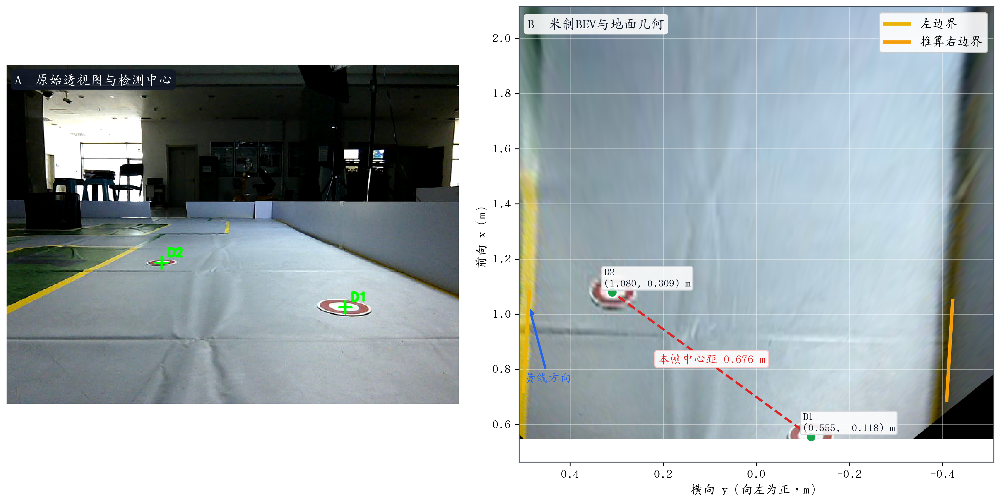
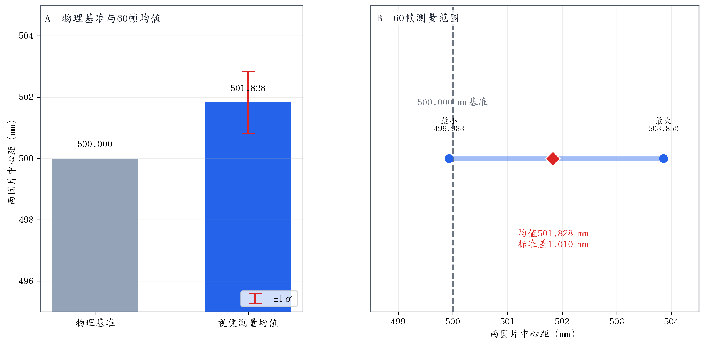
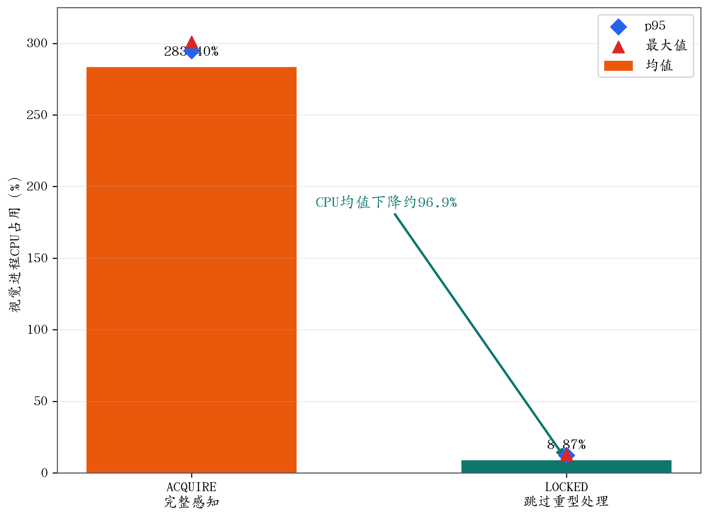
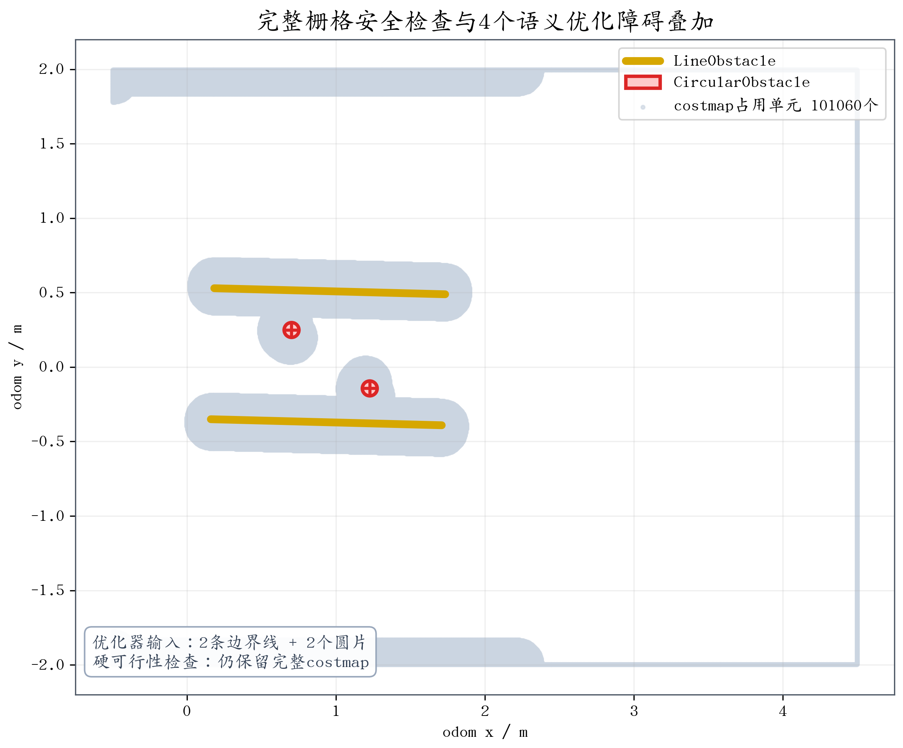
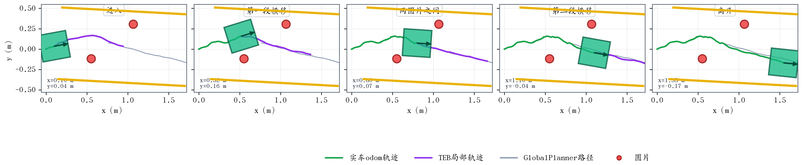
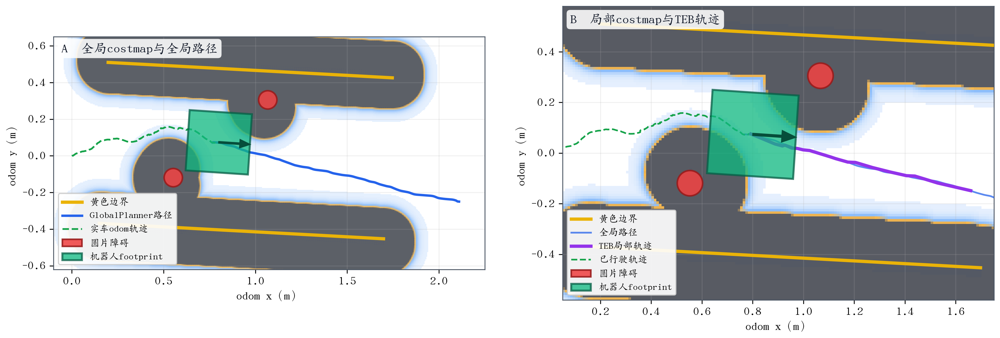
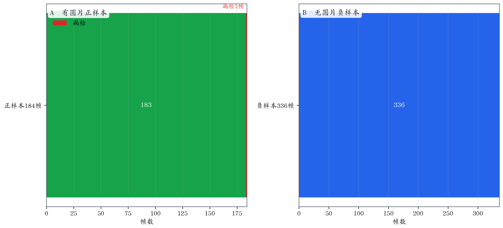

# 黄线赛道视觉避障与规划算法实验总结

日期：2026 年 8 月 25 日

## 1. 项目任务

我在项目中主要负责黄线赛道这一部分，包括黄线检测、红白圆片定位、避障地图生成以及规划算法的测试。人物、锥桶、打靶和 YOLO 检测不是我负责的内容，因此这份总结不展开这些部分。

这一赛段要求小车在两条黄色边界之间行驶，绕开前后错开的两个红白圆片，最后到达窄道入口附近。由于两个圆片通常是一左一右错开摆放，车辆实际需要走出一条 S 形路线。



图 1 黄线避障测试场景

这个任务看起来距离不长，但是对定位和控制的要求比较高。车体大约为 `0.34 m × 0.33 m`，圆片半径按照 `0.05 m` 处理，留给车辆的横向余量并不大。另外，车辆是麦克纳姆轮底盘，绕障时不仅有前进速度，还需要比较明显的横移速度。如果规划器左右来回犹豫，或者相机位置发生一点变化，实车就可能出现擦碰。

## 2. 整体实现思路

现在使用的处理流程可以概括为：

```text
相机图像
  → 黄线和红白圆片检测
  → 转换到米制鸟瞰坐标
  → 固定到 odom 坐标系
  → 生成黄线走廊和圆片障碍
  → 全局路径规划
  → 局部轨迹或路径跟随
  → 底盘执行

激光雷达
  → 累计多帧墙体点
  → 拟合墙面和入口位置
  → 生成导航目标
```

整个系统不是一次确定下来的，而是在实车失败以后逐步改出来的。规划部分最开始测试 DWA，后来换成 TEB；TEB 又先后做了障碍表示和绕行侧选择方面的调整；同时还尝试过 SBPL。比赛后期为了让执行过程更直接，又增加了直接路径跟随器。

## 3. 黄线和圆片检测

### 3.1 黄线检测

黄线部分使用的是传统视觉方法。程序先计算黄色像素的连续置信度，然后沿候选黄线的法向方向选取多个截面。在每一个截面上找颜色和边缘比较明显的位置，再用动态规划把这些位置连接起来，最后用加权直线拟合得到黄线。

一开始考虑过同时检测左右两条黄线，但是实测时右侧黄线经常受到画面边缘、圆片遮挡以及车体姿态的影响。有时两条线都能检测出来，有时右线会突然跳动，反而使道路宽度和中心线不稳定。

后面的正式方案改成以左黄线为主。左线连续稳定后固定到 odom，再按照已知的赛道宽度推算右侧边界。这样做不是说右黄线完全没有信息，而是在当前固定比赛场景中，使用一条质量更稳定的主线效果更可靠。

### 3.2 红白圆片检测

圆片外圈是红色、中心是白色。程序先从图像中找红色区域，再对轮廓做椭圆拟合。之所以不用普通圆检测，是因为圆片平放在地面上，从相机角度看通常是椭圆。

只找到一块红色还不够，程序还会检查：

- 红色是否沿着椭圆外圈分布；
- 20 个角度扇区中有多少扇区存在红色；
- 中间区域是否是低饱和度、高亮度的白色；
- 红环和白心是否大致同心；
- 候选尺寸和地面投影结果是否合理。

检测结果经过连续帧关联，连续确认后才写入导航地图。导航中圆片半径固定使用 `0.05 m`，不会因为某一帧视觉估计的圆片直径发生变化而改变。



图 2 黄线、圆片和鸟瞰图检测结果

### 3.3 米制鸟瞰图和标定

图像中的像素坐标不能直接给规划器使用，因此还需要通过单应变换得到米制 BEV，再把黄线和圆片转换到车体坐标及 odom 坐标。



图 3 双圆片米制 BEV 定位

标定过程中有一个比较明显的问题。相机维修或支架被移动以后，旧外参曾把实际 500 mm 的圆片中心距测成约 381～384 mm。内参没有明显问题，但相机相对地面的姿态已经变了，所以原来的 BEV 不能继续使用。

重新标定以后，500.000 mm 圆心距的 60 帧测量均值为 501.828 mm，标准差为 1.010 mm。另一组 100 帧数据的均值为 500.588 mm、标准差为 0.968 mm。这说明在相机固定的情况下，重复测量比较稳定；同时也说明相机安装一旦变化，必须重新验收，不能只看以前的标定误差。



图 4 米制 BEV 的 500 mm 尺度验证

### 3.4 感知锁定

比赛中的黄线和两个圆片都是静态的。系统最初会完整运行视觉处理，等到黄线走廊和两个圆片的位置都稳定后，将它们固定到 odom，视觉进入 LOCKED 状态。此后不再对每一帧重复执行完整的去畸变、黄线检测、圆片检测和 BEV 计算。

这个过程可以理解为：

```text
ACQUIRE：先把场景看清楚并确认
LOCKED：场景不变，继续使用已经固定的地图
```

在 300 帧 ACQUIRE 测试中，左黄线 300 帧全部检出，每帧都保持两个已确认圆片；黄线质量均值为 0.9096，最低为 0.9036。单帧处理时间均值为 76.45 ms，p95 为 90.49 ms。

进入 LOCKED 后，视觉 CPU 均值从 283.4% 降到 8.87%，下降约 96.9%。这个改动主要解决的是比赛平台上的算力占用，并不是重新设计了检测算法。



图 5 ACQUIRE 和 LOCKED 状态的视觉 CPU 对比

## 4. 规划算法的尝试过程

### 4.1 DWA

最开始采用的是 `GlobalPlanner + DWA`。GlobalPlanner 负责在全局代价地图上找到路线，DWA 根据当前速度采样很多组候选速度，再向前模拟一小段时间，选择局部速度命令。

DWA 当时每个周期大约要评价 `12×14×16=2688` 组速度样本。在 15 Hz 下，单周期只有 66.7 ms，而实际计算经常需要 80～170 ms。后来把控制频率降低到 8 Hz，循环超时确实减少了，但实车仍然没有稳定通过。

典型的一次实车试验中，GlobalPlanner 已经生成了正确的 S 形路线，说明全局并不是没有路。车辆前进约 0.2 m 后，DWA 开始在很小的正负速度之间振荡，22.71 s 后退出并提示 `Robot is oscillating`。这一轮最大横移速度只有约 `0.0218 m/s`。

所以最后没有继续把 DWA 作为主方案。它的问题不只是计算慢，更主要的是在狭窄 S 形路线中，局部速度采样容易停在不稳定的状态。

### 4.2 TEB

为了只比较局部规划器，我保留了相同的 GlobalPlanner、地图和目标，把 DWA 换成 TEB。TEB 不是每次只选一个瞬时速度，而是同时优化一段带时间信息的局部轨迹。

换成 TEB 后，局部轨迹通常有 17～18 个姿态，预测时间约 4 s、长度约 0.88 m，并且能够连续输出前进和横移速度。从运动形式上看，它比 DWA 更适合麦克纳姆轮小车的 S 形绕障。

但是第一次做完整矩形车体扫掠检查时，发现轨迹与近侧圆片的净空约为 `-28.1 mm`。也就是说，TEB 的轨迹点本身看上去没有明显压到圆片，但矩形车体从一个轨迹点运动到下一个轨迹点的过程中仍然可能相交。

后面增加了障碍关联范围、障碍权重和轨迹检查姿态数量，确实出现过 `+56.9～+60.2 mm` 的正净空轨迹，但不可行重置仍然比较频繁。由此可以看出，TEB 的 `min_obstacle_dist` 更接近优化代价，不是硬性的安全距离，最终仍需要单独进行连续扫掠检查。

### 4.3 将 1078 个障碍点改成 4 个语义障碍

继续检查后发现，TEB 当时直接读取了 costmap 中 1078 个点障碍。黄线在地图里本来是一串密集栅格点，TEB 把这些点逐个参与优化，计算量很大。

后面的处理方式是把全局地图和 TEB 输入分开：GlobalPlanner 仍然使用完整 costmap，不删除黄线和圆片；TEB 只接收两条直线和两个圆形障碍。

```text
左黄线：1 个 LineObstacle
右黄线：1 个 LineObstacle
圆片 1：1 个 CircularObstacle
圆片 2：1 个 CircularObstacle
```



图 6 costmap 栅格障碍和 TEB 紧凑语义障碍

在同一锁定场景下进行 A/B，结果如下：

| 指标 | 原 1078 点 | 4 个障碍重复轮 |
|---|---:|---:|
| `move_base` CPU | 70.88% | 15.40% |
| RSS | 65.34 MiB | 56.81 MiB |
| 控制周期均值 | 158.39 ms | 120.20 ms |
| 控制周期 p95 | 491.05 ms | 134.03 ms |
| 超过 187.5 ms 的周期 | 6 | 0 |
| 不可行/重置 | 5 | 0 |

这组数据能比较直接地说明：紧凑障碍减少了局部优化器的计算负担，也改善了控制周期的长尾。但是这一轮属于锁车场景，车辆没有实际执行命令；而且连续扫掠净空仍然出现过负值，所以这项改进主要证明了实时性收益，不能单独用来证明实车更安全。

### 4.4 单侧通道封闭

两个圆片与两侧黄线之间会形成多个看起来都可以通过的小通道。如果完全交给局部规划器临时决定从哪边绕，车辆容易出现左右犹豫。

后面增加了 passage closure：对每一个圆片计算左右两边的可用宽度，把较窄的一侧在全局 costmap 中封闭。这样 GlobalPlanner 会固定选择较宽的一侧，TEB 只负责沿着已经确定的 S 形拓扑生成平滑轨迹。

这个改动的作用主要是把两个问题分开：

```text
从哪边绕：由通道宽度和 GlobalPlanner 决定
具体怎么走：由 TEB 生成连续轨迹
```

2026 年 8 月 12 日，这套 `GlobalPlanner + passage closure + compact TEB` 完成了两次连续 Stage 1 和 Stage 2 实车运行：

| 轮次 | Stage 1 总时间/导航时间 | Stage 2 总时间/导航时间 |
|---|---:|---:|
| A | 51.69/31.59 s | 41.94/29.89 s |
| B | 53.58/33.00 s | 43.90/31.49 s |

两轮各阶段都返回 `SUCCEEDED`。目前这套方案是有连续完整实车记录的回退方案。不过只有两轮，还不能写成所有随机布局都能稳定通过。



图 7 实车绕过双圆片的五个关键时刻



图 8 黄线、圆片、全局路线、TEB 和实车里程计轨迹

### 4.5 SBPL

SBPL 的测试目的是看能不能不使用 passage closure，而是让规划器自己根据车体姿态和运动方式选择绕行侧。

最终使用的候选配置为 1 cm 地图、16 个离散方向和 176 个全向运动基元，规划中考虑 `0.34 m × 0.33 m` 的矩形车体。圆片按照完整圆形区域写入地图，而不是只保留迎车方向的激光表面点。

一次锁车静态试验中，SBPL 从启动到路径就绪用了 14.84 s，得到 792 个路径点，路径长度 2.672 m。两个圆片的连续扫掠最小净空分别为 `+28.2 mm` 和 `+77.4 mm`，稳定后 `move_base` RSS 为 121 MB。

这说明 SBPL 可以在没有人工封侧的情况下自己找到 S 形路线。但是更早的 5 mm 栅格会出现精确目标无解和较高内存；后面的临时实车记录中也既有成功，又有连续 `Solution not found`。由于这些轮次没有按相同格式整理，所以目前只能把 SBPL 作为候选，不能说它已经优于 GlobalPlanner。

### 4.6 直接路径跟随器

比赛后期的 `815final.launch` 实际调用了 `stage1_direct_test.launch`。这一链路仍然使用黄线和圆片检测、雷达入口目标，以及 GlobalPlanner 通过 `/move_base/make_plan` 生成的预览路径，但是不让原 TEB 向底盘发命令，改由 `stage1_direct_path_follower.py` 直接跟踪这条路径。

因此，当前需要分清两套方案：

- 已经有连续完整实车记录的是 GlobalPlanner、通道封闭和 compact TEB；
- 比赛后期入口使用的是 GlobalPlanner 预览路径和直接跟随器。

直接跟随器当前普通段最大线速度为 `0.324 m/s`，末端最大线速度为 `0.42 m/s`，最大角速度为 `0.18 rad/s`。圆片最低净空参数为 5 mm，但 `stop_on_disc_clearance_violation=false`，所以目前这个参数只是记录和提示，并不会因为低于 5 mm 自动停车。

这一方案的控制链比较直接，但统一的多轮实车数据还不够。后面需要先补连续矩形扫掠、黄线走廊和终点墙检查，再和 TEB 在同一参考路径、同一场景下比较。

## 5. 怎样评价算法效果

规划算法不能只看最后有没有返回成功。结合前面的实车情况，我认为至少要看下面几组指标。

| 部分 | 主要指标 | 实际含义 |
|---|---|---|
| 视觉 | 检出率、误检率、坐标波动 | 能不能稳定得到正确场景 |
| 标定 | 已知距离的均值误差和标准差 | 是否存在系统偏差、重复测量是否稳定 |
| 全局规划 | 有解率、规划时间、路径长度、最小净空 | 能不能找到几何上可通过的路线 |
| 局部控制 | 横向误差、角速度、控制周期 p95、重置次数 | 路径是否真的能被底盘平稳执行 |
| 实车 | 是否接触、通过时间、终点位置和姿态 | 最终物理效果 |
| 重复性 | 相同布局和不同布局的多轮成功率 | 结果是不是偶然的一次成功 |

这里有两个容易混淆的地方：

第一，控制周期平均值正常，不代表没有突然很慢的周期，因此还要看 p95 和最大值。8 Hz 对应 125 ms，一旦圆片附近连续出现几百毫秒的长周期，车辆可能还在执行旧命令。

第二，导航器返回 `SUCCEEDED` 不一定等于物理成功。前面的试验出现过软件已经到点但车辆擦到圆片，也出现过两个圆片都没碰、末端却连续反向旋转的情况。因此最后必须同时记录软件状态、物理接触和终点姿态。

## 6. 视觉部分已有结果

圆片专项测试共 520 帧。其中 184 帧包含圆片，183 帧同时检出了两枚圆片，双圆片帧级召回率为 99.46%，最长连续漏检为 1 帧；另外 336 帧为空场，误检为 0。



图 9 红白圆片 520 帧专项测试结果

这组数据是在固定相机和固定测试场景中得到的，可以说明当时场景下检测比较稳定，但不能直接写成任意光照和任意摆放下都有相同效果。

感知计算方面，ACQUIRE 到 LOCKED 的 CPU 下降比较明显；规划计算方面，1078 个点改为 4 个语义障碍以后，`move_base` CPU 和控制周期长尾也明显下降。这两项优化分别减少了视觉和局部规划对计算资源的占用。

## 7. 仿真到实车时出现的问题

现在已经有一个软件影子仿真入口。它使用真实或冻结的感知和地图，规划器输出速度以后，不连接真实底盘，而是用理想运动学积分生成虚拟 odom。

这个环境不是 Gazebo，也没有模拟轮胎、碰撞和雷达反射。它主要用来检查：

- 全局路线是否选错侧；
- SBPL 是否无解；
- TEB 是否反复 infeasible/reset；
- 状态机和终点逻辑是否正确；
- 名义轨迹是否已经发生矩形扫掠碰撞；
- 控制周期是否存在明显长尾。

如果影子仿真在同一位置也失败，问题更可能在地图、路径和规划参数；如果影子仿真能通过、实车却失败，就需要重点检查相机标定、里程计和底盘响应。

目前从仿真迁移到实车主要有下面几个问题：

1. 相机外参对安装位置非常敏感，相机移动后整套 BEV 都可能产生系统偏差；
2. 圆片和黄线固定到 odom 后，如果车轮打滑，世界模型不会主动修正车辆的 x/y 漂移；
3. 真实横移速度可能存在增益不足、死区和响应延迟；
4. 横移与转向可能互相耦合，理想积分没有反映这种情况；
5. 规划器离散检查通过，不代表真实矩形车体连续运动一定有足够净空；
6. 末端靠墙时，较小的位置或航向误差也可能造成较大的物理风险。

下一步准备在现有影子仿真中加入实测底盘响应、odom 漂移、命令延迟和 BEV 正常误差，形成一个比理想积分更接近实车的 Shadow+。这个方案不需要一开始就搭完整物理仿真，也更方便利用现有实车日志。

## 8. 当前结论和后续工作

目前可以明确的结论是：

1. DWA 在这个狭窄全向 S 形任务中出现过正确全局路径下的实车振荡，不继续作为主方案；
2. TEB 比 DWA 更容易产生连续横移，但需要解决障碍数量、连续扫掠和末端行为问题；
3. 4 个紧凑语义障碍显著改善了 TEB 的计算量和控制周期；
4. passage closure、GlobalPlanner 和 compact TEB 组成了当前有连续完整实车记录的回退方案；
5. SBPL 静态规划能够自主找 S 形路线，但实车稳定性还需要重新整理和补测；
6. 直接跟随器是比赛后期采用的执行方式，当前最缺的是统一的安全门和多轮实车结果；
7. 相机、odom、底盘响应和控制延迟的误差分布，是后面继续优化和做强化学习之前最需要补的数据。

接下来的工作准备分三步进行。

第一步先固定三套互不覆盖的启动配置：GP+compact TEB 回退方案、直接跟随方案和 SBPL 方案。同时统一每轮实验的日志格式，重新做当前安装状态的 500 mm 验证，并测试底盘 `vx/vy/ω` 的阶跃响应和命令延迟。

第二步在左错列、右错列、中间最窄和边界扰动四类布局中做公平比较。全局层单独比较 GP 和 SBPL；局部层固定同一条参考路径，再比较 DWA、TEB 和直接跟随器。先跑影子仿真，通过以后再进行低速实车。

第三步再开展强化学习。第一版不让强化学习直接输出完整 `cmd_vel`，而是让它根据横向误差、预测净空、底盘状态和定位置信度，调整参考路径的横向偏置以及速度比例。输出以后还要经过车体连续扫掠、黄线范围、速度加速度和终点墙检查；不满足安全条件时回到原控制器或停车。

这种做法保留了已经完成的视觉和几何规划部分，强化学习只补偿仿真与实车之间的控制误差，后面也比较容易和传统方法做同条件对比。

## 9. 总结

黄线避障部分最终不是只更换了一个规划器，而是经历了从感知、地图表达、全局选路到局部执行的一系列调整。DWA 实车振荡说明全局有路并不代表局部能够执行；换成 TEB 后，车辆具备了连续横移能力，但又暴露出障碍点太多和连续净空不足的问题；将上千个点压缩成两条线和两个圆以后，规划实时性得到明显改善；再加入单侧通道封闭，绕行方向也更加稳定。

目前 GP+passage closure+compact TEB 应继续保留为回退方案，SBPL 和直接跟随器作为独立候选继续比较。后续强化学习不直接替代现有系统，而是建立在底盘辨识和安全检查基础上，重点补偿参考路线与真实执行之间的误差。

