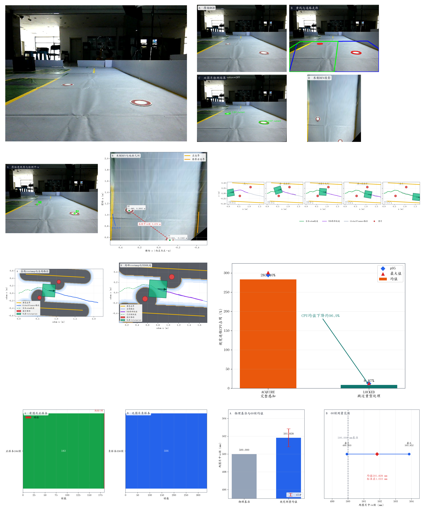

# 黄线避障汇报材料编写方案

更新日期：2026-08-25  
适用范围：`yellow_track_avoidance` 视觉黄线、圆片避障、规划控制与仿真/实车迁移  
明确不包含：人物、锥桶、打靶和 YOLO 模型对比

## 1. 建议把这份材料讲成什么故事

不要把它写成“最终用了某个算法，所以只介绍这个算法”，而应写成一条有证据的技术演进线：

```text
DWA 实车出现采样振荡
  → 换 TEB 验证全向连续轨迹
  → 发现上千点障碍造成实时性和重置问题
  → 用 2 条线 + 2 个圆的紧凑语义障碍替代点云
  → 用单侧通道封闭稳定选择 S 形拓扑
  → 尝试 SBPL 直接在 x/y/yaw 格点中选路
  → 用影子仿真和实车试验暴露连续扫掠、定位和末端控制问题
  → 保留已验证基线，同时为强化学习建立可复现实验接口
```

汇报的核心结论可概括为：本工作不是简单“调了一个规划器”，而是围绕狭窄双圆片场景，完成了感知锁存、障碍表达、拓扑选择、局部轨迹优化、实车标定和仿真—实物验证闭环。

## 2. 推荐正文结构

### 2.1 任务与难点

先用一张实景图说明任务：全向小车沿黄线走廊行驶，避开两枚错列圆片并到达狭窄区域终点。

需要明确四个难点：

1. 双黄线并不总是同等可靠，右线可能被车体、圆片或视场裁切遮挡；
2. 圆片尺寸相对车体很小，但过道余量也小，中心点不碰撞不等于矩形车体扫掠安全；
3. 小车具备横移能力，局部规划器需要稳定地产生连续 `vx + vy`；
4. 相机外参、里程计、底盘响应和雷达稀疏点都会带来仿真—实物差异。

### 2.2 系统算法链

按“输入—处理—输出”介绍，不要一上来罗列 ROS 节点：

```text
RGB 图像
  → 黄色连续置信度、法向截面采样、动态规划、加权直线拟合
  → 单侧可靠黄线 + 已知道路宽度恢复走廊
  → 红环/白心和几何约束检测两枚圆片
  → 米制 BEV 定位并冻结到 odom
  → 完整栅格供全局规划，紧凑语义障碍供局部规划
  → GlobalPlanner 或 SBPL 生成全局路径
  → TEB 或直接路径跟随器生成底盘速度
```

雷达部分单独说明：在任务起点累计扫描并拟合墙体，以稳定的墙几何推算入口或终点；它的作用是避免依赖某一个可能漏检的墙端点。

### 2.3 规划算法对比

每种算法都用同一模板写五件事：为什么试、原理差异、保持不变的条件、看哪些指标、最后结论。

| 方案 | 主要特点 | 已观察效果 | 汇报结论 |
|---|---|---|---|
| GlobalPlanner + DWA | 全局栅格路径 + 局部速度采样 | 全局 S 路线存在，但实车约前进 0.2 m 后正反小幅振荡，22.71 s 报 `Robot is oscillating` | 在本狭窄全向避障场景中淘汰为主方案；失败点在局部执行，不是全局无路 |
| GlobalPlanner + 原始 TEB | 用时空轨迹优化代替离散速度采样 | 能输出连续 `vx + vy`，但早期连续矩形扫掠对圆片出现负净空，并伴随大量不可行重置 | 方向正确，但安全表达和实时性尚不够 |
| GlobalPlanner + 紧凑 TEB | 全局 costmap 保留完整障碍；TEB 只接收 2 条线和 2 个圆 | 障碍数 1078→4，`move_base` CPU 70.88%→15.40%，控制周期 p95 491.05→134.03 ms，不可行/重置 5→0（锁定回放重复轮） | 关键工程改进；解决主要计算浪费，但不能把软约束当成连续碰撞证明 |
| GlobalPlanner + 紧凑 TEB + 单侧封闭 | 对每枚圆片封闭较窄一侧，先确定绕行拓扑，再由 TEB 平滑执行 | Stage 1/2 两次连续完整实车均成功 | 2026-08-12 已验证回退基线 |
| SBPL + 紧凑 TEB | 在 `x/y/yaw` 格点上使用矩形 footprint 和全向运动基元自主选侧 | 1 cm 静态候选 14.84 s 得到 792 点、2.672 m 的正净空 S 路径；后续聊天记录显示实车有成功也有 `Solution not found` | 静态几何能力较强，但搜索时间、内存和闭环稳定性不足，保留为候选对照 |
| 直接路径跟随器 | 沿已生成路径做几何跟随，不让原 TEB 接管底盘 | 后期比赛总启动链采用该分支 | 必须与“GP+TEB 已验证基线”分开表述，不能把其效果归到 TEB |

说明：上表混合了实车、锁定回放和静态规划证据，正式结果页必须另加“证据类型”一列，不能直接按数字排总名次。

### 2.4 实际做出的改进

建议把改进写成“问题—修改—收益—边界”，重点写以下六项：

1. **双线依赖改为单侧可靠线恢复走廊**：避免较差的右黄线把整条道路模型带偏；代价是更依赖道路宽度和 BEV 标定。
2. **ACQUIRE—LOCKED 感知状态机**：场景确认后把黄线和圆片冻结到固定坐标系，视觉 CPU 均值由 283.4% 降到 8.87%，约下降 96.9%。
3. **点障碍改为紧凑语义障碍**：全局规划继续看完整栅格，TEB 只优化 2 条线和 2 个圆，显著降低 CPU 和控制周期长尾。
4. **单侧通道封闭**：把“从哪边绕”从局部连续优化问题，转换成确定的全局拓扑选择，减少局部最优和左右犹豫。
5. **用墙体拟合替代单点终点**：对雷达漏检、稀疏端点更稳健；终点来自多帧、多点几何，而不是一次扫描中的孤立点。
6. **连续矩形扫掠复核**：不只看规划节点中心，也按 5 mm 间距检查车体矩形从相邻姿态扫过的全过程，能发现 TEB 自带离散可行性检查漏掉的碰撞。

相机重新标定和外参恢复也应列为工程改进，而不是“准备工作”。相机移动后，真实 500 mm 曾被视觉测成约 381～384 mm，说明毫米级避障的上限首先受机械安装和 BEV 标定约束。

### 2.5 指标怎么写、效果怎么看

| 类别 | 建议指标 | 怎么判断 |
|---|---|---|
| 检测 | 正样本双目标检出率、负样本误检率、连续帧坐标波动 | 漏检和误检分开报告；520 帧专项中正样本 184 帧有 183 帧双检出，336 帧负样本误检 0，但只代表该专项场景 |
| 标定 | 500 mm 尺度均值误差、标准差、重复安装偏差 | 均值看系统偏差，标准差看重复性；不能只报相机内参 RMS |
| 规划 | 是否找到路径、路径长度、圆片/黄线最小净空、最大相邻航向变化 | 路径短不等于更好；狭窄场景优先保证正净空和连续性 |
| 局部控制 | `cmd_vel` 周期均值/p95、不可行次数、重置次数、振荡退出 | p95 反映最坏一批控制延迟，比均值更能解释实车顿挫；8 Hz 控制目标对应 125 ms 周期，应同时说明测量条件 |
| 实车 | 物理接触、通过时间、终点位置/姿态、重复成功率 | 真实“未碰圆片/墙”优先级高于导航器返回 `SUCCEEDED`；至少报告连续多轮 |
| 仿真迁移 | 同布局下影子仿真与实车的成功一致性、停止位置、最小净空和不可行次数差 | 影子仿真也在同一位置失败，多半是几何/规划问题；影子通过而实车失败，重点排查标定、里程计、底盘和时延 |

建议采用三级结论词，避免说得过满：

- “静态可行”：只证明能规划出正净空路径；
- “闭环可执行”：影子仿真或锁定回放中控制链连续；
- “实车已验证”：有物理无接触、终点正确和重复轮次证据。

### 2.6 仿真到实物迁移

当前已有的不是 Gazebo 全物理比赛仿真，而是**软件影子仿真**：复用真实感知、地图和规划器，以理想速度积分生成虚拟里程计，底盘不接收命令。汇报中应据实这样命名。

迁移过程可以写成：

1. 在目标 x86/ROS Noetic 环境重建插件和依赖；
2. 先做锁车静态规划，确认坐标系、footprint、地图和目标；
3. 用影子里程计闭环运行，筛掉必然的几何/规划失败；
4. 标定相机内参与 BEV 外参，并用已知 500 mm 距离验收；
5. 实车只开放低速单布局，记录 bag、物理接触和控制周期；
6. 根据实测标定偏差、底盘横移/转向响应和末端行为做单变量修正；
7. 连续完整成功后才固化为回退基线。

需要诚实说明影子仿真没有覆盖轮胎打滑、横移耦合、碰撞接触、相机支架微动、雷达反射缺失和真实计算时延，所以它适合筛查算法，不等价于实车验收。

## 3. 配图方案

### 3.1 已有图片，可直接使用

1. 任务实景与检测叠加：`report_assets/chapter3_visual_avoidance_test_20260811/3.2.4.1-视觉避障现场检测效果图.png`
2. 米制 BEV 定位：`report_assets/chapter3_visual_avoidance_test_20260811/3.2.4.2-双圆片米制BEV定位结果.png`
3. 实车 S 形避障五个关键时刻：`report_assets/chapter3_visual_avoidance_test_20260811/3.2.4.3-双圆片S形避障五个关键时刻.png`
4. 障碍建模与规划结果：`report_assets/chapter3_visual_avoidance_test_20260811/3.2.4.4-视觉障碍建模与规划结果.png`
5. ACQUIRE—LOCKED CPU 对比：`report_assets/chapter3_visual_avoidance_test_20260811/3.2.4.5-ACQUIRE_LOCKED视觉CPU对比.png`
6. 520 帧检测验收：`report_assets/chapter3_visual_avoidance_test_20260811/3.2.4.6-红白圆片520帧专项验收统计.png`
7. 500 mm 尺度验收：`report_assets/chapter3_visual_avoidance_test_20260811/3.2.4.7-米制BEV的500mm尺度验证.png`
8. 紧凑语义障碍对照：`report_assets/second_group_visual_avoidance_right_mirror_20260811/B09-costmap栅格与紧凑语义障碍对照.png`

总览图如下，正式文档中应拆成单图使用：



### 3.2 建议补做的图片

1. **算法演进图**：DWA→原始 TEB→紧凑 TEB→单侧封闭→SBPL 候选→直接跟随，节点下标失败原因和去留；
2. **规划器 A/B 路径叠加图**：同一冻结场景、同一 footprint 和同一终点下画 DWA/GlobalPlanner、SBPL、TEB 轨迹及圆片净空；
3. **性能双图**：左图为 1078→4 障碍数和 CPU，右图为控制周期 p95 与不可行次数；
4. **影子仿真—实车对照图**：同一布局上下排列，标出仿真停止点、实车轨迹、物理接触与终点偏差；
5. **相机标定前后图**：标出 500 mm 真值、迁移后错误测量和重新标定结果；
6. **比赛场地完整实景图**：目前素材更偏检测截图，建议补一张俯视或斜俯视全景，让车、黄线、两枚圆片和终点同时可见。

其中第 2、4 项必须从同一场景数据重新生成，不能拿不同试验条件的曲线拼成“公平对比”。

## 4. 建议的篇幅和讲法

给老师的简单材料控制在 10～14 页最合适：

1. 任务与难点：1 页；
2. 系统链路和传统视觉：2 页；
3. DWA、TEB、SBPL 对比：3 页；
4. 三项主要改进：紧凑障碍、通道封闭、感知锁存，共 3 页；
5. 指标与实车结果：2 页；
6. 仿真—实物迁移及问题：2 页；
7. 当前结论和强化学习计划：1 页。

强化学习部分建议定位为下一阶段研究，不要倒过来否定已有确定性基线。可以让强化学习学习局部残差、参数选择或通道决策，并始终与 DWA、GP+TEB、SBPL+TEB 以及当前直接路径跟随器做同场景 A/B。

## 5. 写作时必须避免的口径错误

- 不写 YOLO 对比，因为它不是本人的工作范围；
- 不把锁定回放说成实车，也不把软件影子仿真说成 Gazebo 全物理仿真；
- 不把导航器返回 `SUCCEEDED` 等同于物理成功，早期试验出现过“状态成功但擦碰/末端行为错误”；
- 不把 2026-08-12 的 GP+TEB 回退基线和后期 `815final.launch` 的直接路径跟随器混成一个最终算法；
- 不把 SBPL 的一次静态成功写成全面优于 GlobalPlanner；
- 不将 TEB 的 `min_obstacle_dist` 解释为硬净空保证，它是优化代价，仍需连续矩形扫掠和实车复核；
- 道路宽度需统一口径：内侧有效宽度、黄线宽度和两线中心距要分别定义，避免历史文档中的 0.91 m 被重复用于不同含义。

## 6. 本方案依据的主要材料

- `docs/navigation/COMPETITION_PLANNER_BASELINE_REPORT_20260810.md`
- `docs/navigation/PERCEPTION_ACQUIRE_LOCKED_REPORT_20260810.md`
- `docs/navigation/TEB_COMPACT_OBSTACLE_AB_REPORT_20260810.md`
- `docs/navigation/STAGE1_REAL_RUN_REPORT_20260810.md`
- `docs/trials/VALIDATED_STAGE12_BASELINE_20260812.md`
- `docs/trials/SBPL_STAGE1_STATIC_CANDIDATE_20260812.md`
- 2026-08-07 至 2026-08-20 的 Codex 会话记录
- 当前比赛入口 `/home/mowen/bit_ws/src/nav_demo/launch/815final.launch`

