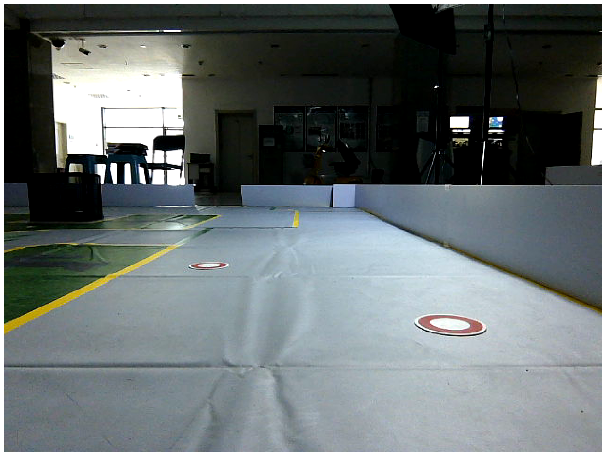
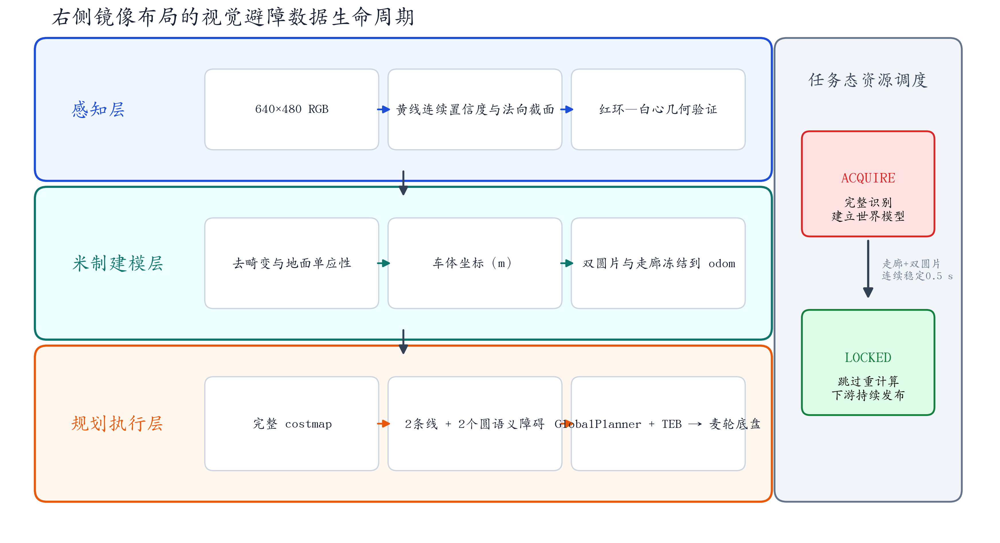
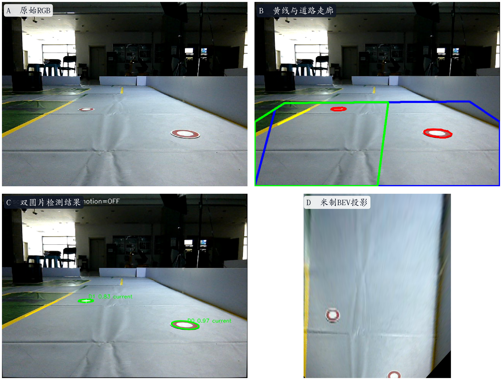
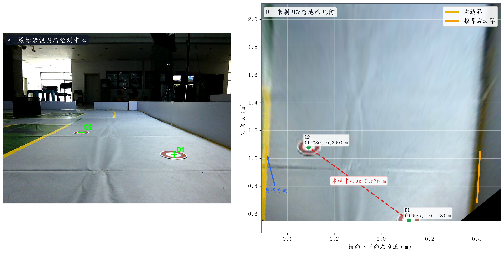
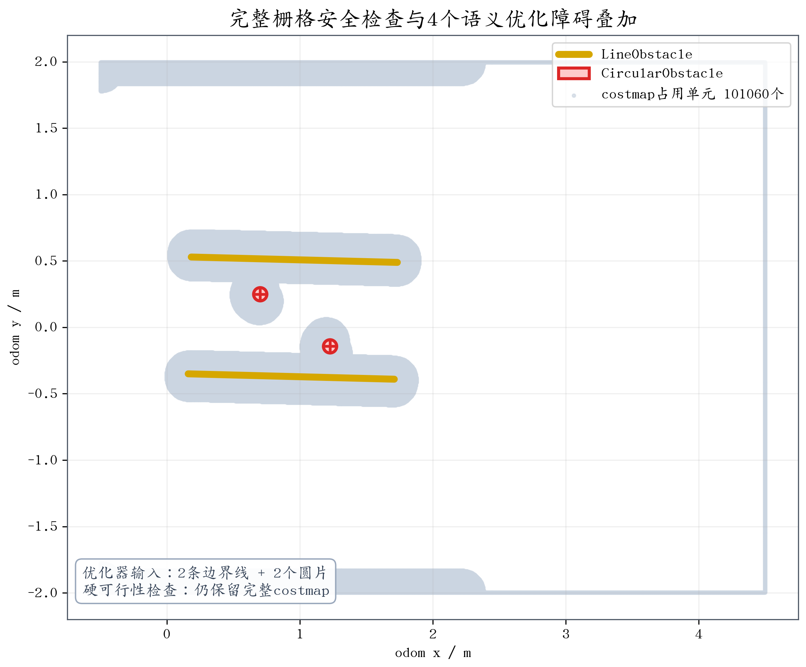
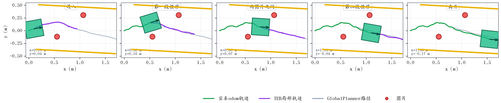
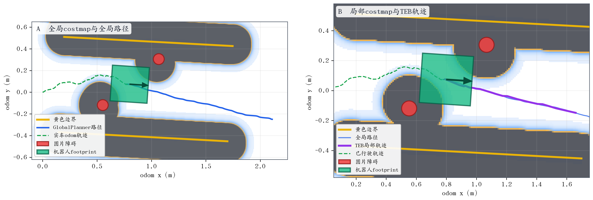
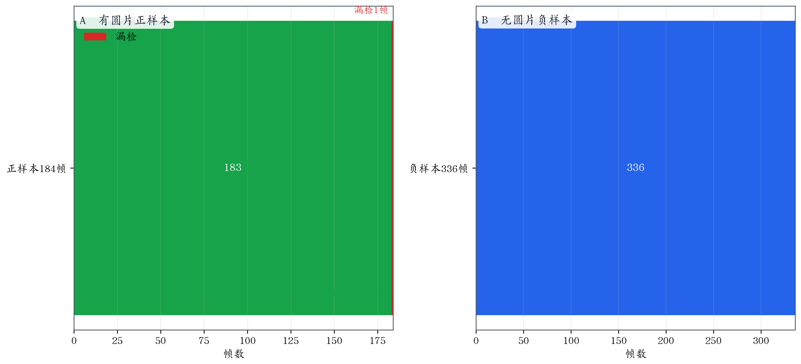
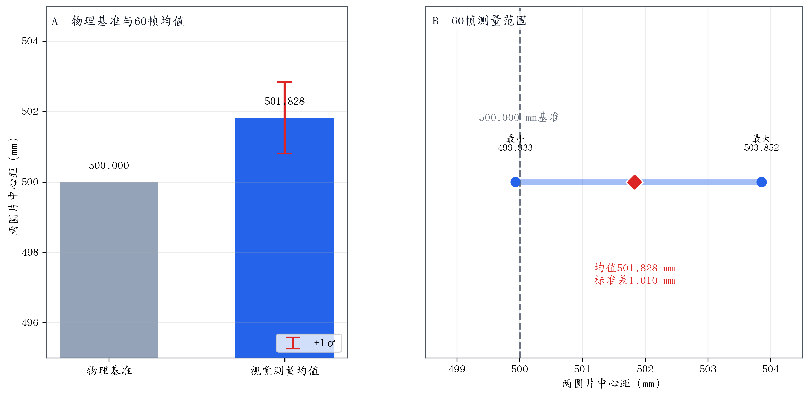
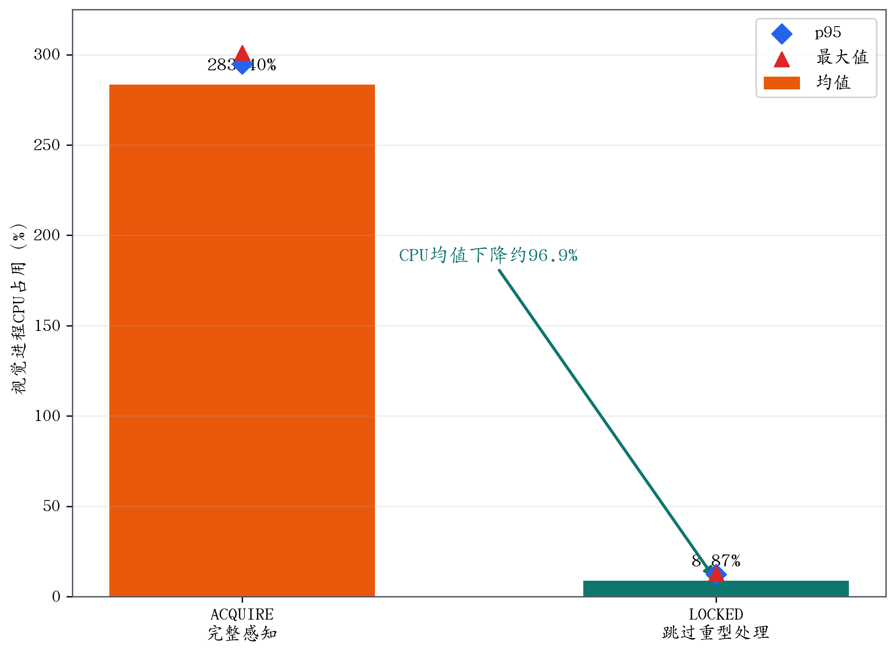

# 黄线避障算法对比与仿真实物迁移阶段技术报告

版本：阶段冻结稿  
日期：2026-08-25  
项目：侦察小车黄线走廊双圆片避障  
范围：`yellow_track_avoidance` 包及其比赛集成链  
不包含：人物、锥桶、打靶及 YOLO 模型对比

## 摘要

本文面向侦察小车在黄色边界狭窄走廊内绕过两枚错列圆片并到达指定区域的任务，总结传统视觉感知、环境建模、全局规划、局部控制、软件影子仿真和实车迁移过程。系统采用黄色连续置信度、法向截面采样、动态规划和加权直线拟合提取可靠黄线，采用红色环带、白色中心、椭圆几何和多帧确认检测两枚圆片，并通过米制鸟瞰变换将场景冻结到里程计坐标系。

规划控制方面先后测试了 `GlobalPlanner + DWA`、`GlobalPlanner + TEB`、紧凑语义障碍 TEB、带单侧通道封闭的 GlobalPlanner+TEB、SBPL XYTheta Lattice+TEB，以及后期直接路径跟随器。DWA 在全局路径正确的情况下仍出现实车局部振荡；TEB 能生成更符合全向底盘特性的连续 `vx+vy` 轨迹，但早期受到连续扫掠净空不足和大量点障碍计算开销的限制。将 TEB 的障碍输入由 1078 个 costmap 点压缩为 2 条线和 2 个圆后，`move_base` CPU 由 70.88% 降至 15.40%，控制周期 p95 由 491.05 ms 降至 134.03 ms。进一步使用单侧通道封闭确定绕行拓扑后，GlobalPlanner+紧凑 TEB 完成两次连续 Stage 1/Stage 2 实车运行，形成当前有实车证据的回退基线。

SBPL 已在锁车静态场景中自主生成正净空 S 形路径，但搜索时间、内存和实车闭环稳定性尚不足以替换基线。后期比赛入口采用直接路径跟随器实际控制底盘，该分支与历史 TEB 基线必须分开评价。本文最后给出证据分级、评价指标、软件影子仿真边界，以及“不确定度感知、安全屏障和受限残差策略”的后续强化学习研究方案。

关键词：黄线检测；圆片避障；GlobalPlanner；DWA；TEB；SBPL；紧凑语义障碍；sim-to-real；安全残差强化学习

## 1. 任务背景与报告边界

### 1.1 任务描述

小车需要在左右黄色边界形成的狭窄区域内行驶，绕过两枚前后错列的红白圆片，并到达雷达确定的入口或终点区域。两枚圆片迫使车辆先向一侧横移、再向另一侧回正，形成典型 S 形轨迹。



图 1 反坦克雷区域视觉避障测试场景（车载相机视角）

车体规划 footprint 约为 `0.34 m × 0.33 m`，圆片按半径 `0.05 m` 建模。在该尺度下，只判断机器人中心点是否避开圆片是不充分的；必须判断矩形车体在相邻姿态之间的连续扫掠区域是否与圆片或黄线相交。

### 1.2 主要技术难点

1. 左右黄线观测质量并不相同。右侧黄线容易受到视场裁切、圆片遮挡和车辆姿态影响，双线同时检测的稳定性低于选择一条可靠主线。
2. 圆片尺寸小、通道余量小，像素级偏差、BEV 外参偏差和里程计漂移均可能把规划正净空变成实车接触。
3. 麦克纳姆轮底盘需要连续横向速度，局部控制器不仅要“找到路”，还要稳定执行 S 形横移。
4. 感知、costmap 和局部轨迹优化共享有限计算资源，控制周期长尾会造成命令老化、顿挫和规划重置。
5. 理想运动学仿真没有覆盖横移打滑、死区、时延、轮速耦合、相机支架变化和真实雷达反射，仿真通过只能作为实车准入条件。

### 1.3 证据分级

为避免将不同条件下的数据直接排名，本文使用以下证据等级：

| 等级 | 含义 | 能够支持的结论 |
|---|---|---|
| R4 | 实车闭环 | 物理通过、接触、终点和真实控制表现 |
| R3 | 锁定场景/锁车回放 | 算法时序、规划输出和已冻结几何下的安全审计 |
| R2 | 软件影子仿真 | 理想或参数化运动学闭环的可执行性 |
| R1 | 静态规划 | 是否能找到路径及路径几何指标 |
| R0 | 未统一固化的聊天或临时记录 | 只作为后续复现实验的线索 |

本文中的结果表均标明证据等级。R1～R3 的“成功”不能替代 R4 实车无接触验收。

## 2. 系统总体方案

### 2.1 分层架构

系统将感知、世界模型、全局拓扑、局部轨迹和底盘执行分开，使每次试验能够只改变一个主要变量。

```text
RGB 图像
  → 黄线与圆片几何检测
  → 米制 BEV
  → odom 固定场景
  → 完整 global/local costmap
  → GlobalPlanner 或 SBPL
  → TEB 或直接路径跟随器
  → 底盘速度命令

激光雷达
  → 多帧墙体拟合与聚类
  → 入口/终点几何
  → 规划目标
```



图 2 视觉避障分层架构与任务态调度

### 2.2 黄色边界检测

黄线检测没有使用神经网络，而是通过颜色、局部截面和全局连续性共同约束：

1. 在 HSV/Lab 等颜色空间生成黄色连续置信度，而不是只使用单一二值阈值；
2. 沿候选边界法向进行多截面采样，计算颜色支持、显著度和局部边缘得分；
3. 使用动态规划连接跨截面的稳定支持点，抑制局部反光和断裂；
4. 使用加权总体最小二乘拟合直线，输出有效观测范围内的线段；
5. 由支持率、颜色置信度、显著度、拟合残差、覆盖率和几何一致性形成整线质量分数。

历史试验表明，双黄线同时检测不如单侧主线稳定。正式模式因此优先检测左黄线，待方向和横向位置连续稳定后锁定到 odom，再依据已知道路宽度恢复另一侧走廊。该设计减少了弱右线对道路模型的干扰，但也使系统更加依赖道路宽度先验和 BEV 外参。

### 2.3 红白圆片检测

圆片检测使用颜色和结构联合判定：

- 两段红色色相范围提取红色候选；
- 通过轮廓和椭圆拟合适应地面圆片的透视形变；
- 将红环分成 20 个扇区，检查角向覆盖率和最大连续缺失；
- 用低饱和度、高亮度和 Lab 中性色确认白心；
- 检查红环与白心同心性、候选尺寸、置信度和重复目标；
- 地面投影后进行多帧关联，连续确认后才允许写入正式世界模型。

导航障碍半径固定为 `0.05 m`。视觉估计直径仅用于候选筛选和标定诊断，避免远近视角造成的直径波动直接改变导航障碍尺寸。



图 3 原始图像、黄线走廊、双圆片检测与米制 BEV

### 2.4 米制 BEV 与场景冻结

相机图像先去畸变，再通过地面单应变换映射到米制鸟瞰图。圆片和黄线由图像坐标转换到车体坐标，并使用图像采集时刻的 `odom←base_link` 变换固定到 odom，避免车辆移动期间使用错误时刻的 TF。



图 4 双圆片米制鸟瞰定位结果

确认后的圆片和走廊属于静态比赛场景，因此系统采用 `ACQUIRE→LOCKED` 状态机：

```text
ACQUIRE：完整执行图像处理、黄线/圆片检测、BEV 和跟踪
LOCKED：世界模型完整后停止重型视觉，只保留静态地图发布和状态监测
```

LOCKED 不是通用动态场景方案，而是面向“一次获取、一次通过”的比赛资源调度。只有显式 reset 才重新进入 ACQUIRE。

### 2.5 雷达墙体和目标生成

雷达目标不依赖单帧中的一个墙端点。系统在起点累计多帧扫描，使用多点拟合、聚类和稳健统计获得墙体几何，再生成入口或终点。其目的在于解决正前方墙点或端点稀疏、反射不稳定时的目标跳变问题。

该方法应表述为“由多帧墙体几何推算终点”，不能写成始终能稳定检测某一个特定墙点。

## 3. 规划与控制算法对比

### 3.1 算法职责差异

| 算法 | 所在层级 | 核心机制 | 本任务中的主要优点 | 主要限制 |
|---|---|---|---|---|
| GlobalPlanner | 全局规划 | 在二维代价地图上搜索栅格路径 | 速度快、工程成熟，配合通道封闭可稳定选择 S 拓扑 | 不显式将航向作为搜索状态，狭窄场景需要额外拓扑策略 |
| DWA | 局部控制 | 在当前速度附近采样候选速度并前向模拟 | 实现成熟、参数直观 | 狭窄全向 S 形任务中易出现局部振荡 |
| TEB | 局部控制 | 联合优化带时间信息的轨迹姿态和速度 | 能输出连续 `vx+vy`，适合全向横移 | 障碍数多时计算长尾明显，安全距离是软代价而非硬保证 |
| SBPL XYTheta Lattice | 全局规划 | 在 `x/y/yaw` 状态格上使用运动基元搜索 | 能显式考虑矩形 footprint、航向和全向运动 | 搜索时间、内存和精确目标无解问题较突出 |
| Direct Follower | 路径执行 | 使用前视点和几何误差直接跟踪参考路径 | 链路短、控制行为易解释 | 强依赖参考路径、定位和底盘模型，当前硬安全门不足 |

GlobalPlanner 与 SBPL 是全局规划器，DWA、TEB 和直接跟随器主要属于局部执行层，因此正式公平对比应分为“全局规划对比”“相同参考路径下的局部控制对比”和“整套系统对比”三个层级。

### 3.2 DWA 试验与淘汰原因

早期方案为 `GlobalPlanner+DWA`。DWA 配置包含约 `12×14×16=2688` 组速度采样和 1.5 s 前向模拟。在 15 Hz 控制下，单周期预算为 66.7 ms，而实际计算常见 80～170 ms。将控制频率降至 8 Hz 后，循环超时明显减少，但没有消除局部最优和速度振荡。

典型实车 Trial 3 中，GlobalPlanner 已经生成有效 S 形路线，DWA 仍在约前进 0.2 m 后进入近零速度的前后振荡，并于 22.71 s 报告 `Robot is oscillating`。该轮最大初始横移速度约 `0.0218 m/s`，最大纵向速度约 `0.0827 m/s`。

因此，DWA 的失败不能归因于“全局没有路径”，而是局部速度采样在狭窄全向 S 形执行中的稳定性不足。DWA 被保留为历史对照，不再作为工程主线。

证据等级：R4。

### 3.3 原始 TEB：运动能力改善但安全性不足

将局部规划器替换为 TEB 后，全局规划器、地图和场景保持不变。TEB 能生成 17～18 个姿态、约 4 s、0.88 m 的未来轨迹，并连续输出正向和横向速度，证明其运动形态比 DWA 更适合全向 S 形绕障。

然而，对矩形 footprint 进行 5 mm 间距的连续扫掠复核时，早期轨迹与近侧圆片出现约 `-28.1 mm` 的负净空。扩大障碍关联范围、检查更多轨迹姿态并提高障碍权重后，曾出现 `+56.9～+60.2 mm` 的正净空轨迹，但也存在不可行轨迹和周期性重置。

TEB 内置 feasibility 检查本质上是有限分辨率的离散碰撞检测；`min_obstacle_dist` 是优化代价，而不是数学意义上的硬净空约束。因此“TEB 报可行”不能替代连续矩形扫掠审计。

证据等级：R3。

### 3.4 紧凑语义障碍改进

原始 TEB 直接读取 costmap 障碍时，feedback 中包含 1078 个点。系统将全局安全地图和局部优化输入分层：

```text
GlobalPlanner/costmap：保留完整黄线栅格、圆片区域和激光障碍
TEB：只接收 2 个 LineObstacle + 2 个 CircularObstacle
```



图 5 完整栅格障碍与紧凑语义障碍的分层表达

严格锁定场景 A/B 结果如下：

| 指标 | 1078 点障碍 | 紧凑障碍首轮 | 紧凑障碍重复轮 | 效果解释 |
|---|---:|---:|---:|---|
| TEB feedback 障碍数 | 1078 | 4 | 4 | 消除局部优化中的冗余点障碍 |
| `move_base` CPU | 70.88% | 15.62% | 15.40% | 重复轮下降约 78.3% |
| RSS | 65.34 MiB | 56.81 MiB | 56.81 MiB | 内存同步下降 |
| `cmd_vel` 周期均值 | 158.39 ms | 122.46 ms | 120.20 ms | 基本接近 8 Hz 的 125 ms 周期 |
| `cmd_vel` 周期 p95 | 491.05 ms | 139.78 ms | 134.03 ms | 显著消除控制周期长尾 |
| 周期 >187.5 ms | 6 | 0 | 0 | 所测窗口内长周期归零 |
| infeasible/reset | 5 | 1 | 0 | 优化稳定性明显改善 |

证据等级：R3。

该 A/B 足以证明计算和时序改进，但不能单独证明安全性提高。紧凑重复轮的连续扫掠圆片净空仍存在负值，说明几何安全问题必须独立评价。

### 3.5 passage closure 与 GP+TEB 基线

两枚错列圆片会形成左右候选通道。如果完全交给局部连续优化器选择，容易出现左右犹豫或局部最优。系统因此对每枚圆片计算两侧通道宽度，并在全局 costmap 中封闭较窄一侧：

```text
passage closure：决定从哪侧通过，解决拓扑选择
GlobalPlanner：生成确定的全局 S 形路径
compact TEB：平滑并执行全向局部轨迹
```

这一改进不是修改 TEB 数学模型，而是把离散拓扑选择从局部连续优化中分离出来。

2026-08-12，`GlobalPlanner+passage closure+compact TEB` 完成两次连续 Stage 1/Stage 2 实车运行：

| 轮次 | Stage 1 总时长 | Stage 1 导航 | Stage 2 总时长 | Stage 2 导航 | 结果 |
|---|---:|---:|---:|---:|---|
| Run A | 51.69 s | 31.59 s | 41.94 s | 29.89 s | 两阶段均 `SUCCEEDED` |
| Run B | 53.58 s | 33.00 s | 43.90 s | 31.49 s | 两阶段均 `SUCCEEDED` |

证据等级：R4。

两轮能够证明该链存在可重复完整运行能力，但样本量仍不足以宣称高可靠率或覆盖全部随机布局。因此将其冻结为回退基线，而不是称为绝对最优算法。



图 6 实车通过双圆片区域的五个关键时刻



图 7 黄线、圆片、GlobalPlanner、TEB 与实车 odom 轨迹

### 3.6 SBPL 候选

SBPL 候选关闭 passage closure，使用 1 cm 地图、16 个离散航向、176 个全向运动基元、矩形 footprint 和完整圆片占用云，使规划器在 `x/y/yaw` 状态空间中自主选择绕行侧。

锁车静态结果为：

| 指标 | 结果 |
|---|---:|
| 从启动到路径就绪 | 14.84 s |
| 路径位姿数 | 792 |
| 路径长度 | 2.672 m |
| 横向范围 | -0.395～+0.215 m |
| 两枚圆片最小净空 | +28.2/+77.4 mm |
| 扫掠复核间距 | 5 mm |
| `move_base` 稳定 RSS | 121 MB |

证据等级：R1。

该结果证明 SBPL 能在不人工封侧时自主生成正净空 S 形路径。更早的 5 mm 格点方案存在精确目标搜索失败和 481～623 MiB 内存占用。后续非标准化记录中既有实车成功，也有持续 `Solution not found` 的失败，因此在补齐统一日志前，SBPL 只能作为研究候选，不能替换实车基线。

### 3.7 直接路径跟随器候选

后期比赛总入口 `815final.launch` 调用 `stage1_direct_test.launch`。该启动链继续复用黄线/圆片感知、雷达目标，以及 `/move_base/make_plan` 在当前 GlobalPlanner 配置下生成并发布到 `/yellow_track_avoidance/stage1_lidar_goal_plan` 的预览路径；但它将原 `move_base/TEB` 与底盘命令物理断开，真正控制底盘的是 `stage1_direct_path_follower.py`。

因此必须区分：

- **Baseline-E**：`GlobalPlanner+passage closure+compact TEB`，已有 R4 连续完整运行证据；
- **Candidate-D**：GlobalPlanner 预览路径+直接几何跟随器，是当前比赛候选链，但缺少统一多轮 R4 A/B。

Candidate-D 当前 wrapper 中的主要默认值包括普通段最大线速度 `0.324 m/s`、末端最大线速度 `0.42 m/s`、最大角速度 `0.18 rad/s`、最低圆片诊断净空 `0.005 m`，且 `stop_on_disc_clearance_violation=false`。这意味着 5 mm 目前只是告警/记录阈值，不是硬停车约束。它在升格为工程基线前，需要补充连续扫掠、走廊约束和终端墙约束构成的统一在线安全门，并完成标准化多轮实车记录。

证据等级：当前启动链事实为已核对配置；算法效果仍属于待补 R4 证据。

## 4. 本项目的主要改进

| 原始问题 | 改进方法 | 已证明收益 | 仍有边界 |
|---|---|---|---|
| 双黄线质量不一致 | 检测可靠单侧主线并由道路宽度恢复走廊 | 减少弱右线对世界模型的干扰 | 依赖道路宽度和 BEV 外参 |
| 静态场景重复重型感知 | `ACQUIRE→LOCKED` 世界模型锁存 | 视觉 CPU 均值 283.4%→8.87% | 只适合静态一次性任务；锁定后不主动修正漂移 |
| TEB 读取上千点障碍 | 全局完整栅格+局部 4 个语义障碍 | CPU、RSS、控制周期 p95 和重置均改善 | 不等于连续安全保证 |
| 局部优化器左右犹豫 | passage closure 先确定较宽通道 | 形成可重复实车基线 | 属于任务先验策略，随机场景仍需验证 |
| 雷达端点可能漏检 | 多帧墙体拟合、聚类和稳健统计 | 目标不再依赖单个稀疏点 | 仍受反射、墙面可见范围影响 |
| 离散碰撞检查可能漏碰 | 5 mm 连续矩形 footprint 扫掠审计 | 发现 TEB 节点可行但中间扫掠碰撞 | 当前主要用于离线/试验复核，尚未成为所有链的在线硬安全屏障 |
| 相机移动导致世界坐标失真 | 重做内参/外参与 500 mm 尺度验收 | 固定安装下恢复毫米量级重复性 | 机械安装变化仍会使历史外参失效 |

其中，紧凑语义障碍和 ACQUIRE→LOCKED 主要是工程资源优化；passage closure 是拓扑稳定策略；连续扫掠审计和标定复验则是安全证据建设。正式汇报中应区分这些改进的性质。

## 5. 评价指标及效果判读

### 5.1 感知指标

| 指标 | 解释 | 判读原则 |
|---|---|---|
| 双圆片帧级检出率 | 有目标时两枚同时检出的比例 | 漏检与单目标检出需单独统计 |
| 负样本误检率 | 空场被误认为存在圆片的比例 | 不能只报召回率 |
| 连续帧坐标跨度/标准差 | 检测位置稳定性 | 数值小只表示重复性，不等同于绝对精度 |
| 黄线质量分数 | 支持率、颜色、显著度、拟合和覆盖综合质量 | 应同时报告均值和最小值 |
| 单帧耗时 p95 | 最慢 5% 帧的处理时间 | 比均值更能反映资源竞争风险 |

### 5.2 标定指标

已知尺度的均值误差反映系统偏差，标准差反映固定安装下的重复性。内参重投影 RMS 很低并不代表地面 BEV 一定正确；相机支架发生变化时必须重新做米制尺度验收。

### 5.3 规划与控制指标

| 指标 | 主要回答的问题 |
|---|---|
| 找到路径率/首次解时间 | 全局规划器是否稳定有解、多久给出首条路径 |
| 路径长度/航向变化 | 路线效率与几何平滑性 |
| 连续扫掠最小净空 | 完整矩形车体是否真正避开圆片和黄线 |
| 横向跟踪误差 mean/p95/max | 控制器能否执行相同参考路径 |
| `cmd_vel` 周期 mean/p95/max | 控制命令是否实时、是否存在长尾 |
| infeasible/reset/oscillation | 规划控制失稳的类型与频次 |
| 实车物理接触 | 最高优先级失败条件，优先于软件状态 |
| 终点位置/航向误差 | 是否正确停止，而不只是穿过圆片 |
| 多轮成功率 | 是否具有重复性，必须说明布局和样本数 |

对于 8 Hz 控制，理论周期为 125 ms。后续可暂用以下试验准入规则，但它们属于待验证的工程门槛，不是现有行业标准：

- 绿色：p95≤150 ms，且 `dt>187.5 ms` 比例低于 1%；
- 黄色：150 ms<p95≤187.5 ms，只进入影子或低速实车；
- 红色：p95>187.5 ms，或关键区域出现 `dt>250 ms`，不进入高风险正式实车。

### 5.4 物理成功的定义

一轮完整成功至少同时满足：

1. 软件任务状态完成；
2. 车体、轮组和外壳均未接触圆片或墙体；
3. 连续扫掠安全审计通过；
4. 终点位置和姿态在规定范围内；
5. 未出现人工急停、持续反转或安全门高频接管。

早期实车曾出现“导航器返回到点但擦碰圆片”，以及“两枚圆片未碰但末端高频反向旋转”的情况，说明不能把 `SUCCEEDED` 直接等价为物理任务成功。

## 6. 已有实验结果

### 6.1 圆片检测专项验收

固定专项数据共 520 帧：正样本 184 帧中有 183 帧同时检出两枚圆片，帧级召回率为 99.46%；负样本 336 帧中误检 0 帧。最长连续漏检为 1 帧。



图 8 红白圆片 520 帧专项验收结果

证据等级：感知专项实测。该结果只代表固定相机、固定场景和对应光照，不能外推为全部随机布局的普适识别率。

### 6.2 米制 BEV 尺度

实际 500.000 mm 圆心距的 60 帧测量均值为 501.828 mm，标准差为 1.010 mm，范围为 499.933～503.852 mm。另一次 100 帧正式记录的均值为 500.588 mm、标准差为 0.968 mm，100% 落入 ±5 mm。



图 9 米制 BEV 的 500 mm 尺度验证

相机维修或支架移动后，旧外参曾把真实 500 mm 测成约 381～384 mm；重新标定后才恢复正常。这一失败比单次高精度结果更能说明：机械安装状态是米制避障的关键配置，赛前必须制度化复验。

### 6.3 感知锁存性能

ACQUIRE 阶段连续 300 帧中，左黄线 300/300 检出，两枚 raw/confirmed 圆片状态保持 300/300；黄线质量均值/最小值为 0.9096/0.9036，处理耗时均值/p95/最大值为 76.45/90.49/103.59 ms。

进入 LOCKED 后，视觉 CPU 均值由 283.4% 降到 8.87%，下降约 96.9%；原始图像仍以约 29.52 Hz 到达，但 919 个回调均在 `cv_bridge` 前跳过，圆片扫描和走廊点云仍持续发布。



图 10 ACQUIRE 与 LOCKED 状态下的视觉 CPU 占用

证据等级：真实相机 R3 资源 A/B。

### 6.4 规划器阶段结论汇总

| 方案 | 证据 | 已证明 | 尚未证明 | 当前定位 |
|---|---|---|---|---|
| GP+DWA | R4 | 正确全局路径下仍会局部振荡失败 | 调参后在全部布局均不可用 | 历史对照 |
| GP+原始 TEB | R3 | 能输出连续全向轨迹 | 稳定连续正净空和实时闭环 | 已被紧凑表达改进 |
| GP+compact TEB | R3/R4 | 显著降低计算长尾；可参与实车闭环 | 单靠 TEB 软约束提供硬安全 | 基线组成部分 |
| GP+closure+compact TEB | R4 两轮完整 | 存在可重复完整运行能力 | 高可靠率、全部随机布局 | 冻结回退基线 |
| SBPL+compact TEB | R1，另有 R0 线索 | 无封侧时可自主规划正净空 S 路径 | 稳定实车闭环优于 GP | 研究候选 |
| GP 预览路径+Direct | 配置已核对，R4 统计不足 | 当前比赛链实际采用 | 安全性和优于 TEB | 比赛候选 |
| 安全残差 RL | 尚无结果 | — | 全部性能结论 | 后续研究方案 |

## 7. 软件影子仿真与实物迁移

### 7.1 当前仿真能力

工程已具备 `competition_stage1_shadow_auto.launch` 和理想里程计积分节点。该环境复用真实或冻结感知、地图、全局规划和局部控制，将输出速度积分成虚拟 odom，底盘不连接。

它属于软件影子仿真，不是 Gazebo 全物理仿真。它可以发现：

- GlobalPlanner 拓扑或 passage closure 选侧错误；
- SBPL `Solution not found`；
- TEB infeasible/reset；
- 终点状态机错误；
- CPU 和控制周期长尾；
- nominal 连续 footprint 扫掠碰撞。

如果同一冻结场景在影子仿真和实车中都在相近位置失败，应优先检查规划几何和状态机；如果影子仿真稳定通过而实车失败，则应优先检查 BEV、里程计、底盘响应和时延。

### 7.2 已观察到的 sim-to-real 问题

| 来源 | 实物表现 | 当前处理 | 仍需补充的数据 |
|---|---|---|---|
| 相机外参变化 | 圆片世界坐标产生大系统偏差 | 重标定和已知尺度验收 | 当前机械安装的重复复验分布 |
| odom 漂移 | 软件到点但物理终点/横向位置偏差 | 固定世界模型和低速测试 | 前进、横移、旋转、S 轨迹重复误差 |
| 底盘横移与转向 | `vy/ω` 响应慢、死区、耦合或打滑 | 限速和实车调参 | 增益、时间常数、死区、饱和和耦合矩阵 |
| 命令延迟和抖动 | 圆片附近命令老化、顿挫 | 紧凑障碍和控制频率调整 | command→actual motion 延迟分布 |
| 雷达反射稀疏 | 单点端点漏检、目标跳变 | 多帧拟合和稳健统计 | 不同角度/距离的墙体可见性 |
| 离散碰撞审计 | 节点可行但中间扫掠可能碰撞 | 5 mm 连续矩形扫掠 | 在线安全门的实时开销与接管效果 |

### 7.3 Shadow+ 建议

下一步不必立即搭建完整 Gazebo 动力学环境，可在现有影子仿真中加入实测模型，形成 Shadow+：

```text
理想运动学积分
  + 底盘 Kx/Ky/Kω 增益
  + 一阶响应时间常数
  + vx/vy/ω 死区与饱和
  + x-y-ω 交叉耦合
  + command latency 与 dt jitter
  + odom bias/random walk
  + 正常安装状态下的 BEV 误差
```

相机被明显移动造成的 500 mm→381 mm 属于配置故障，应由赛前检查拒绝，而不是作为普通随机噪声加入训练。

### 7.4 安全净空门槛

当前不应直接把 5、10 或 20 mm 当作通用安全距离。建议根据实测最终净空误差定义：

\[
M_{safe}=Q_{99}(|e_{clearance}|)+M_{reserve}
\]

其中 `e_clearance` 应综合反映 BEV/圆片定位、odom、底盘横向跟踪、控制延迟、footprint 和圆片尺寸误差。该公式是后续实验设计，不是当前已经标定完成的门槛。

## 8. 当前冻结状态

### 8.1 工程基线

正式冻结名称建议为：

```text
Baseline-E：GP + passage closure + compact TEB
```

冻结内容包括传统视觉、ACQUIRE/LOCKED、米制 BEV、odom 场景、完整 costmap、单侧通道封闭、GlobalPlanner、4 个紧凑语义障碍和 TEB。新试验不应静默修改其默认 YAML、插件或启动入口，并应始终能够一键退回该基线。

### 8.2 独立候选

```text
Candidate-D：GlobalPlanner 预览路径 + Direct Follower
Candidate-S：SBPL XYTheta Lattice + compact TEB
```

两条候选均需使用独立配置、独立启动入口和独立结果目录。Candidate-D 首先补在线安全门和统一实车日志；Candidate-S 首先补同地图分辨率下的 GP/SBPL 静态公平对比，再决定是否进入实车闭环。

## 9. 后续强化学习研究方案

### 9.1 研究定位

强化学习不直接替换图像感知，也不在第一阶段端到端输出 `vx/vy/ω`。推荐研究线为：

```text
Research-R：Uncertainty-aware Safe Residual Navigation

冻结几何感知
  → 确定性 nominal path
  → 确定性直接跟随器
  → RL 调整参考路径/速度
  → 硬安全屏障
  → 底盘
```

传统系统已经能完成任务，研究问题应集中在现实误差下“安全裕度与运行效率”的矛盾。RL 只学习传统控制器未补偿的低维残差，可保留可解释性和回退能力。

### 9.2 建议状态与动作

第一版 observation 可包含：横向误差、航向误差、目标距离、实际 `vx/vy/ω`、上一控制命令、两圆片相对位置、左右通道净空、预测扫掠净空、BEV/几何置信度、odom 不确定度、命令年龄和上一动作。

第一版 action 仅为：

```text
Δy_ref：参考路径横向偏置
α_v：参考速度尺度
```

即：

\[
y'_{ref}=y_{ref}+\Delta y,\qquad v'_{ref}=\alpha_v v_{ref}
\]

第二阶段才考虑受限 `Δvy/Δω`，不建议第一版同时输出完整底盘速度。

### 9.3 安全屏障

RL 动作必须依次经过：

```text
动作限幅
→ 速度/加速度约束
→ 短时域连续 footprint 扫掠
→ 走廊包含约束
→ 终端墙约束
→ 数据新鲜度与不确定度检查
→ 安全命令
```

投影不到安全集合时回退 nominal controller；仍不安全时受控停车。安全不能只依靠碰撞惩罚让策略自行学习。

### 9.4 公平实验设计

后续比较分三层：

1. **全局规划层**：同一 frozen map/start/goal/footprint 下比较 raw GlobalPlanner 与 raw SBPL，两者均不使用 passage closure；
2. **局部控制层**：冻结完全相同参考路径，比较 DWA、TEB、Direct 和 Direct+RL；
3. **整套系统层**：比较 GP+DWA、GP+closure+compact TEB、SBPL+compact TEB、Direct 和 Safe Residual RL。

最低布局应覆盖左错列、右错列、中间最窄和边界扰动四类。影子筛选建议每算法每布局不少于 10 轮；实车先每布局 5 轮工程筛选，最终候选再每布局 10 轮。运行顺序采用分块随机化，避免电池、温度和地面状态成为隐藏变量。

这些轮次属于后续计划，不能写入当前结果表。

## 10. 下一阶段工作安排

### 10.1 第一阶段：补齐误差链与统一日志

1. 固化 `Baseline-E`、`Candidate-D`、`Candidate-S` 三个独立分支；
2. 建立逐轮 logger，记录场景 ID、标定 ID、软件/物理成功、接触、净空、跟踪误差、速度、控制周期、CPU、重置和终点误差；
3. 在当前机械安装状态下重做 500 mm 尺度验证；
4. 分别执行 `vx/vy/ω` step response，估计增益、时间常数、死区、饱和、耦合和延迟；
5. 将后期 SBPL、TEB 和 direct follower 临时试验补成统一 CSV/rosbag 摘要；
6. 为 direct follower 增加在线连续扫掠和走廊/终点安全门。

### 10.2 第二阶段：传统算法公平对比

1. 在四类布局中完成 GP/SBPL 静态 A/B；
2. 对同一参考路径完成 DWA/TEB/Direct 影子对比；
3. 使用系统辨识结果完成 Shadow+；
4. 从实测误差分布确定 `M_safe`；
5. 只将通过影子和安全门的方案送入低速实车。

### 10.3 第三阶段：安全残差强化学习

比较以下消融组：

1. nominal direct follower；
2. residual RL，不输入不确定度；
3. residual RL+不确定度+安全屏障；
4. 无安全屏障 RL，仅在仿真中作为消融，不进入实车。

最终实车主表优先比较 Baseline-E、Candidate-D 和 Safe Residual RL。SBPL 只有在前期闭环表现达到准入门槛后才进入最终主表；DWA 作为历史基线保留。

## 11. 结论

本项目已经形成从传统视觉、米制 BEV、静态世界锁存到全局规划和全向局部控制的完整链路。算法演进表明：DWA 的主要问题是正确全局路径下的局部振荡；TEB 改善了全向轨迹形态，但暴露出连续扫掠安全和上千点障碍计算长尾；紧凑语义障碍显著降低了 CPU 和控制周期 p95；passage closure 将离散拓扑选择从局部优化中分离，最终与 GlobalPlanner 和 compact TEB 组成已跑通的回退基线。

SBPL 证明了无人工封侧的 XYTheta 静态规划能力，但尚未形成足够的实车稳定证据。直接路径跟随器是后期比赛候选链，其当前安全阈值主要用于诊断，必须补齐在线硬安全门和标准化实车 A/B。软件影子仿真已能筛查规划与逻辑问题，但真实相机外参、odom、底盘横移/转向动态和控制时延仍是 sim-to-real 的主要缺失证据。

因此，下一阶段最优先的工作不是继续零散调整规划参数，也不是直接训练端到端强化学习，而是测量“相机/里程计/底盘/时延到最终净空误差”的完整分布。在此基础上建立 Shadow+、安全净空门槛和统一实验矩阵，再研究不确定度感知、带硬安全屏障的参考路径与速度残差策略。

## 附录 A：建议的逐轮日志字段

```text
run_id, algorithm, layout_id, scene_geometry_id, calibration_id
software_success, physical_contact, wall_contact, safety_abort, terminal_valid
min_swept_clearance_disc1, min_swept_clearance_disc2, min_corridor_clearance
path_length, run_time, navigation_time
mean_abs_lateral_error, p95_lateral_error, max_lateral_error
max_vx, max_vy, max_omega, rms_omega, rms_delta_vy, rms_delta_omega
cmd_dt_mean, cmd_dt_p95, cmd_dt_max
cpu_mean, cpu_p95, rss
infeasible_count, reset_count, oscillation_count, solution_not_found_count
terminal_position_error, terminal_yaw_error
```

## 附录 B：主要证据来源

- `docs/RAICOM技术报告视觉部分全面初稿_20260810.md`
- `docs/navigation/COMPETITION_PLANNER_BASELINE_REPORT_20260810.md`
- `docs/navigation/PERCEPTION_ACQUIRE_LOCKED_REPORT_20260810.md`
- `docs/navigation/TEB_COMPACT_OBSTACLE_AB_REPORT_20260810.md`
- `docs/navigation/STAGE1_REAL_RUN_REPORT_20260810.md`
- `docs/navigation/STAGE1_TRIAL1_TRIAL2_GPT_HANDOFF_20260810.md`
- `docs/trials/VALIDATED_STAGE12_BASELINE_20260812.md`
- `docs/trials/SBPL_STAGE1_STATIC_CANDIDATE_20260812.md`
- `docs/perception/DISC_DETECTION_ACCEPTANCE.md`
- 2026-08-07 至 2026-08-20 的项目试验会话记录
- 当前比赛入口 `/home/mowen/bit_ws/src/nav_demo/launch/815final.launch`
- 当前第四区域入口 `/home/mowen/bit_ws/src/nav_demo/launch/stage1_direct_test.launch`
